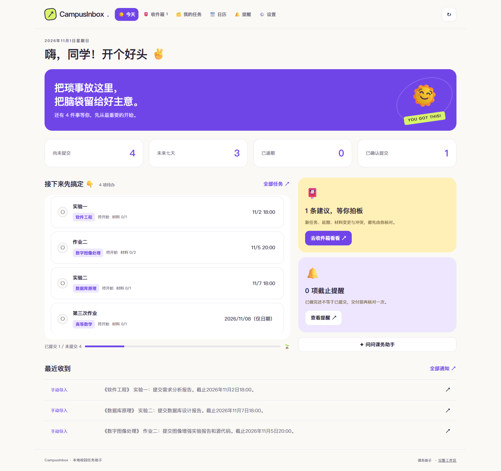

# CampusInbox · 校园任务助手

把课程通知整理成清晰的学习任务，在一个地方查看截止时间、核对材料和记录提交进度。

当前版本使用 Vue 3 界面，连接本项目的 Python 服务与 SQLite 数据库。通知识别后先生成草稿，由你核对后加入任务清单；基础文本处理无需模型 API Key。

## 界面预览



截图使用独立测试数据，不包含个人课程或账号信息。[查看手机宽度界面](docs/images/mobile.png)。

## 快速开始

需要 Python 3.10 或更高版本。

1. 下载或克隆本分支代码。
2. 双击根目录的 **启动融合版.cmd** 或 **start.cmd**。
3. 浏览器打开 [http://127.0.0.1:8877](http://127.0.0.1:8877)。启动窗口保持运行，关闭服务可按 `Ctrl+C`。
4. 进入 **我的任务 → 新建任务**，选择文本粘贴、图片上传、文件上传或手动填写。

仓库包含 `web/ui` 构建产物，日常使用不需要安装 Node.js。图片和 Office / PDF 文件的 MinerU 云端解析需单独配置，见[新建任务与附件解析](docs/task-import.md)。

使用 Windows 桌面登录与后台采集时，运行 **start-desktop.cmd**。已有程序需从系统托盘退出后重新启动，才能加载后端更新。连接入口位于 **设置 → 数据源连接**，可打开学习通同步和手机连接。

## 主要功能

- **今天**：优先查看未逾期的待办，汇总近期截止、提交进度和待核对消息。
- **我的任务**：按课程、关键词和状态筛选，维护材料清单、截止日期与任务进度。
- **收件箱**：核对识别结果、延期与冲突，查看任务对应的通知原文。
- **日历**：按周或月查看截止安排，导出 `.ics` 日历。
- **提醒**：显示提醒窗口内尚未到期的任务，支持已读和稍后提醒。
- **设置**：配置数据源连接、查看模型状态、导出数据与备份说明。

首页待办和“尚未提交”筛选排除已逾期、已提交及已取消任务。提交进度按“已提交 ÷（已提交＋未逾期的待完成任务）”计算。

“已做完”和“已提交”分别记录；本地标记提交不代表平台回执，软件不会代交作业。只有日期的截止保持为日期，不补造具体时刻。网页通知需要授权，页面关闭后不运行；桌面与手机提醒的使用范围见对应文档。

## 数据与配置

任务、通知、附件和本机配置保存在 `data/`。完整备份前先停止服务，再复制整个目录；恢复时停止服务，将备份放回原位置。

- `.env` 保存可选模型与解析服务配置，参考 `.env.example`。
- 基础文本流程在本地处理；启用外部模型或 MinerU 时，相关文字或文件会发送至对应服务。
- `.env`、`data/`、访问令牌和登录会话不应提交到仓库。
- 网页 JSON 导出不包含附件二进制，不能代替完整目录备份。

## 开发与验证

前端开发需要 Node.js 24.12+ 或 26。

```powershell
cd frontend
npm ci
npm run dev
```

开发服务器默认使用 `http://127.0.0.1:5175`，API 代理至运行中的 Python 服务 `8877`。修改前端后，构建到 `web/ui`：

```powershell
npm test
npm run build
```

完整回归从项目根目录执行；浏览器检查需要 Playwright 和 Edge，使用独立临时数据库：

```powershell
powershell -NoProfile -ExecutionPolicy Bypass -File scripts/check-integrated.ps1 -Browser
```

主要源码：`frontend/` 为 Vue 界面，`courseinbox/` 为业务与 API，`web/` 包含静态资源与内嵌业务工作区，`desktop-app/` 和 `desktop-sync/` 提供 Windows 桌面与采集功能，`android/` 为可选手机客户端。

## 进一步阅读

- [界面融合与运行说明](docs/ui-integration.md)
- [新建任务与附件解析](docs/task-import.md)
- [Android 客户端](android/README.md)
- [浏览器采集组件](browser-companion/README.md)
- [QQ Connector](docs/qq-connector.md)
- [API 文档](docs/API.md)
- [验收记录](docs/verification/acceptance.md)
- [历史版本与旧版说明](docs/project-history.md)

新版界面与统一新建任务交互参考小组项目 [Elias-2z/CampusInbox](https://github.com/Elias-2z/CampusInbox)，具体来源提交与适配范围见[融合说明](docs/ui-integration.md#来源)。
