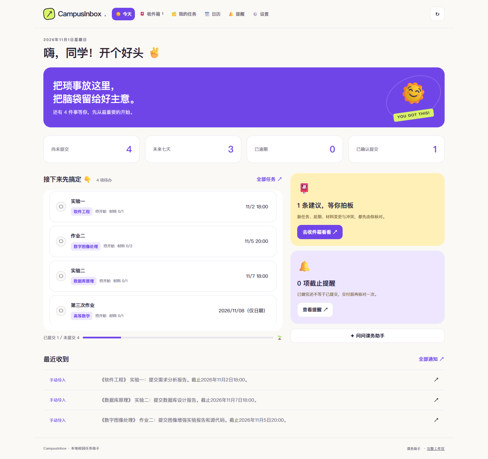

# 历史版本说明

本文归档此前 README 的版本记录与旧版使用说明；其中界面、端口、安装包和本机验收状态仅代表记录当时的情况。当前使用入口以[项目首页](../README.md)为准。

---

> **融合副本（2026-11-01）**：此目录已接入新版 Vue 界面。双击 `启动融合版.cmd` 或 `start.cmd`，打开 http://127.0.0.1:8877 。原项目目录不变。
> 已接入小组仓库最新的「我的任务 → 新建任务」四种创建方式与 MinerU 附件解析；配置、恢复和备份要求见 [新建任务说明](../docs/task-import.md)。更新后重启启动窗口以加载新增后端接口。
> 新版首页、任务、日历、提醒、设置接入本项目原 API；复杂审核、详情、同步、手机连接与评测复用完整业务工作区并统一样式。旧入口为 `/legacy.html`。
> 使用说明和验收范围见 [融合说明](../docs/ui-integration.md)。下面保留原项目功能说明，其中旧目录和端口请以本说明为准。

# CampusInbox · 校园智能任务Agent

项目统一名称为 **CampusInbox**。Windows 构建产物为 `artifacts/desktop/CampusInbox-Learning-Assistant.exe`，仍通过 `start-desktop.cmd` 启动；Android 构建项目为 `CampusInboxCompanion`，新导出安装包使用 `campusinbox-learning-版本-debug.apk` 命名，并保留旧文件名供已有下载链接使用。Python 模块 `courseinbox`、Android 应用 ID 与配对协议标识保持兼容。

把学习通、课程群和教务通知，整理成**有原文依据、需要确认的学习任务**。
本地运行：Android 应用把消息与任务保存在自己的手机，Windows/Web 版保存在自己的电脑。基础版不需要模型 API Key。



[查看手机宽度界面](../docs/images/mobile.png) · [验收记录](../docs/verification/acceptance.md)

## 电脑端任务维护与评测（2026-10-20）

- 一条消息中以分号、句号或换行分开的明确作业/实验，可以各自生成草稿并保留各自截止和材料。重复的通知标题与正文保留一项；“以上均延期”等明确共享截止应用于各项。已选择的课程不会被正文中的《参考书名》替换。所有新增、延期和冲突仍须确认。
- 相同列表摘要不会把已补读成功的详情重新变为“待读取”；实际要求变化仍需重新核对。
- “学习通同步 → 导出检查报告”纳入完整任务核对计数。目录未盘点、栏目失败、原文缺失、提取失败及详情/媒体缺口会阻止自动就绪；待确认、已忽略、归档和清理各自保留。报告不导出课程名称、任务标题、平台编号或正文。
- 网页左侧“识别评测”（`http://127.0.0.1:8765/#evaluation`）可对照原文标注、查看指标/耗时图、逐条检查、运行规则/本机模型对比、停止评测及导出报告。未核对消息不评分，网页报告保存在 `data/evaluation/`，也可查看已有命令行报告。
- 双击 `start-evaluation.cmd`，运行已有人工标注的规则评测，命令行报告保存在 `artifacts/evaluation/`。操作及演示/用户试用步骤见 [电脑端评测与验收](../docs/desktop-evaluation.md)。评测只读正式库，模型使用独立空任务库，同轮比较使用同一份SQLite快照。

消息分句仍是有限规则，复杂指代或未明确区分的任务需人工核对。原有真实标签仅10条、没有延期用例；待标注消息不能算人工核对完成，不能据此宣称达到PPT的100–200条、≥90%或数秒级目标。微信/QQ可粘贴、截图导入；QQ另支持 [OneBot v11本机事件Connector](../docs/qq-connector.md)，需配置外部消息桥，不直接读取Windows QQ。真实账号接入效果仍待验证，见 [Connector接口与范围](../docs/CONNECTORS.md)。

## 手机浏览器接收电脑提醒（2026-10-20）

手机无需安装程序。电脑和手机连接同一 Wi-Fi，打开电脑版网页“手机连接”，点击“开启电脑提醒”，在手机浏览器访问页面显示的地址（`http://电脑私有IPv4:8766/`）。电脑生成六位配对码，在手机网页填写配对码和名称，即可查看电脑采集的新消息、任务变化和截止提醒。网页提供提示音开关、停止/恢复、断开和本地提醒记录；任务仍在电脑核对。

保持手机网页在前台时约每15秒检查；锁屏或切到后台可能暂停，返回网页后补收。当前是前台网页提醒，未提供锁屏系统推送；后者需要 HTTPS 与 Web Push 支持。电脑需保持运行与学习通后台采集。Android浏览器与iPhone浏览器都可以尝试打开网页，但真实手机及iPhone Safari尚未验收。

主服务仍为 `127.0.0.1:8765`，独立提醒服务使用8766。本机已配置仅本地Wi-Fi子网访问的防火墙规则；其他电脑可先预览 `scripts/configure-reminder-firewall.ps1`，再以管理员身份加 `-Apply` 执行。首次配对及课程初次盘点的存量不集中提醒；断线期间新增任务保留，回执去重，配对令牌独立。电脑页面可查看在线状态或撤销设备。

手机App是可选客户端，浏览器连接不要求安装APK。原手机上传通知功能继续保留。正在运行的电脑版需从托盘退出后重新双击 `start-desktop.cmd` 以加载新接口。详见 [验证记录](../docs/verification/mobile-reminders-2026-10-20.md)。

## 电脑版任务核对与补收（2026-10-19）

桌面主窗口点击“任务核对与补收”，或进入网页“学习通同步”。核对清单每页20项，按平台课程、班级、任务编号及实际内容版本，对照本地保存的原文，分别显示未保存、未识别、待确认、已关联任务、历史归档、已忽略和已清理。倒计时变化不会变成新的缺失项；真实要求、截止和状态变化仍单独核对。可查看各课程作业/考试栏目的未检查、读取失败和身份缺口，以及详情需补读或人工核对的情况。

同步运行时，后台优先补收缺失原文、重试失败的自动提取和已支持的详情；按10/20/40/60秒退避、分批安排。页面提供“补收缺失项”“补收此项”和“重试此栏目”。失败栏目保留此前清单，重启后重新验证覆盖状态；不恢复已忽略、归档或主动清理的记录，不自动确认任务。核对限于当前可读取的平台列表，不代表隐藏历史、其他页面或附件正文已完整覆盖。真实发布到 Windows 通知显示的现场验收仍需另行进行。

## 电脑版学习通更新（2026-10-16）

双击 `start-desktop.cmd` 使用。旧程序正在运行时，先从系统托盘退出后重新打开；电脑和软件需要保持运行。

- 自动读取时，首次接收就已过期、明确结束或已提交的新任务候选进入“消息收件箱 → 历史归档”。原文保留，可以“恢复并重新核对”。仍有效的旧任务和无截止任务继续待确认；已确认任务不会被此策略移除。
- 消息按原发布时间从新到旧排列，发布时间未知时用接收时间。“消息记录”支持每页 50 条、选择本页、清理所选和清理全部。清理确认期间的新消息不会被删除。任务、待确认草稿及关联原文保留；其他消息正文删除，轻量指纹长期保留，防止补读后重新出现。
- “学习通同步”新增“立即重新检查”，显示进度是否停滞、列表和详情覆盖缺口，以及需要人工核对的图片/附件。后台异常退出、心跳或进度停滞会限次恢复并复用登录；长期失败可手动重新检查。
- Windows 窗口和托盘新增“桌面提醒”开关。常驻程序每 30 秒检查新任务、变更和截止提醒，关闭网页仍可接收。首次已有草稿及各课程列表的首轮存量建立提醒基线，之后的新任务才提醒；一个课程失败不会关闭其他已完成初始盘点课程的提醒。提醒回执写入本地数据库，重开程序不重复投递。
- 有精确截止的已确认任务按 24 小时、2 小时和逾期提醒；只有日期时按前一天/当天上午 9 点、次日上午逾期提醒，不补造截止时刻。已提交/取消停止提醒，改期使用新截止。旧数据库升级前自动备份到 `data/backups/*-before-desktop-reliability-*.sqlite3`。

受控测试与真实账号验收范围见 [电脑版完善记录](../docs/verification/desktop-learning-reliability-2026-10-16.md)。Windows 勿扰或系统通知设置可能影响实际显示；关闭整个软件、关机期间不会投递提醒。

2026-10-17 修复课程通知与作业中心把同一作业识别成两个任务：统一“作业：《课程名》”等来源前缀，优先使用课程、班级及作业/考试的稳定平台编号，忽略链接签名和显示名称变化。不同平台编号不因同名而合并，多条同名且身份不明确时阻止再次创建。较早来源也可以关联身份；明确截止只在确认后补充到尚未知截止的任务。本机截图中的重复任务已在备份后合并，原记录、两份来源和旧链接保留，详见 [去重修复记录](../docs/verification/desktop-task-deduplication-2026-10-17.md)。

进一步加固：完整平台身份写入数据库唯一登记，确认、来源关联和身份登记使用同一事务，防止并发确认、重启、显示名变化或未识别标记绕过检查。等价待确认来源共用一份草稿，重新识别和附件补读保留全部来源，使用最新等价原文的真实时间；字段存在差异时分别核对。编号缺失或名称相近的疑似重复进入核对状态，阻止直接创建；“仅关联原文”不会修改已有截止和进度。升级前自动备份，验证范围见 [任务身份唯一性记录](../docs/verification/task-identity-invariants-2026-10-17.md)。


## 手机应用：Android 0.3.21

0.3.20 缩减安装包：默认 ARM 手机版为 23.9 MB，另提供 [ARM64 精简版 17.1 MB](../artifacts/mobile/courseinbox-learning-0.3.20-arm64-debug.apk)，相较 0.3.19 的 47.2 MB 分别减少约 49% 和 64%。保留离线中文识图和现有功能，只按设备 CPU 架构选择本地库；代码、全部模型/网页资源和保留下来的本地库与 0.3.19 逐字节相同。ARM64 版仅供支持 arm64-v8a 的设备使用，默认版同时包含 32/64 位 ARM；x86/x86_64 开发环境可另行构建 universal。均沿用原签名，可覆盖安装。见 [0.3.20 验证记录](../docs/verification/mobile-apk-size-0.3.20.md)。

0.3.19 保留无明确截止日期的任务，清单标注“未明确”，日历下方也单独列出。收件箱与全部消息按原发布时间从新到旧排列，时间未知时使用首次接收时间；首页可直接核对消息对应的任务。“全部消息 → 清理”支持勾选当前页或清空列表，经确认后清理；已有任务及其引用原文保留，未引用的消息正文删除，去重标记避免同步后立即补回。见 [0.3.19 验证记录](../docs/verification/mobile-inbox-cleanup-0.3.19.md)。

0.3.18 修正读取历史通知时误建新任务：自动读取的学习通课程通知、聊天和系统通知，在首次入库时已过明确截止日期的内容只保存原文；“任务结束提醒”不产生新任务。覆盖安装后，只把先前误建且尚未确认的历史草稿标为忽略，保留原文、已确认任务及读取当时仍有效的草稿。只有日期的截止按北京时间当天结束判断，不按消息发布时间一刀切丢弃仍有效的作业。见 [0.3.18 验证记录](../docs/verification/mobile-historical-tasks-0.3.18.md)。

0.3.17 修正“已登录但没有读取课程通知”的入口流程：收件箱和全部消息的“刷新”、首页“同步学习通”直接请求课程通知；如先进入登录页，登录成功后继续打开原请求来源。按每批最多 5 条完成一轮可见通知检查（上限 100 条），保存后自动返回收件箱，并显示实际保存、新任务、未读与保存失败数。门户登录不再覆盖读取结果为“保存 0 条”。切后台保留待接收结果与已落盘批次，整轮最多请求一次新任务提醒。真实账号串联验证已检查 13 条、保存 13 条、生成 9 条待确认草稿；这不代表实体手机后台验收通过。见 [0.3.17 验证记录](../docs/verification/mobile-source-flow-0.3.17.md)。

0.3.16 修复课程通知静态模板没有正文、因此作业未入库的问题：空正文时读取同一官方页面使用的只读详情接口，核对通知身份后保存原文。网页读取新生成任务草稿后，每批请求一次本机任务提醒，重复扫描不重复提醒。修正“作业:”前缀截短任务名，并识别原文明示的“结束时间”为截止。已用本次真实作业核对任务名称及 10 月 21 日 21:16 的截止，实际提醒仍需手机验证；网页补收仅在课程通知页打开时运行，不能据此声称后台系统通知漏收已彻底解决。见 [0.3.16 验证记录](../docs/verification/mobile-notice-task-0.3.16.md)。

0.3.15 根据 iQOO 13 的最新反馈修正等待提示：0.3.14 最终可以连接，但用户观察需约 1～3 分钟。新版取消 25 秒后的“仍未连接”弹窗，等待时显示实际耗时，连接回调到达后自动更新状态；超过三分钟显示“连接较慢”，保留手动排查入口。“我的 → 连接诊断”可复制服务创建、绑定、连接回调和系统异常记录，不含消息正文或登录信息。本次没有更改系统绑定策略，尚不能声称连接更快，见 [0.3.15 验证记录](../docs/verification/mobile-notification-waiting-0.3.15.md)。

0.3.14 针对 iQOO 13 覆盖升级后“通知使用权仍开启、接收服务未连接”的再次反馈：普通重绑后仍无连接回调时，在 Android 14 及以上限次重建监听绑定，不修改系统授权。应用保持打开时约 15 秒后尝试；后台重试可能被系统延后。手机“我的 → 手机提醒”会显示是否执行过重建。能否替代该手机上的手动关开仍待实机验证，见 [0.3.14 验证记录](../docs/verification/mobile-notification-binding-reset-0.3.14.md)。

0.3.13 在手机“全部消息”增加“识别图片”：从系统文件选择一张 PNG/JPG/BMP/WebP 图片，在手机本机用随 APK 打包的中文 OCR 识别文字；核对、修改文字后保存，能识别出的学习任务进入待确认草稿，原图保存在应用私有存储并可从消息详情查看。图片最大 8 MB，不识别无文字的图表或学习通页面内尚未导入的图片。未填写消息原发布时间时，不据此推断“明天”等相对截止日期。详见 [手机图片导入验证记录](../docs/verification/mobile-image-import-0.3.13.md)。

0.3.12 针对覆盖安装后“通知使用权仍开启、接收服务却未连接”的情况，修复迟到断开回调并在升级、开机和打开应用时限次自动重连。用户曾反馈单次重传测试成功，但随后再次确认每次更新仍需手动切换授权，详见 [验证记录](../docs/verification/mobile-notification-recovery-0.3.12.md)。

[下载手机安装包](../artifacts/mobile/courseinbox-learning-0.3.21-debug.apk)，支持 Android 8.0 及以上的 ARM 手机。包含首页、消息、任务、截止日历和账号五个页面，可独立使用，不要求先启动电脑。0.3.10 修复通知使用权已开启但监听服务尚未完成重连时过早跳转系统授权页的问题；应用会等待连接回调，超时后再提供手动排查入口。通知栏补收及新消息提醒沿用 0.3.9 行为。0.3.5 将已验证的官方课程封面主机 `p.ananas.chaoxing.com` 的 HTTP 图片地址升级为 HTTPS，兼容顶层页面动态加载，不依赖手机样式；跨域嵌入内的图片不受外层注入影响，手机布局中需点“展开课程页”。不放开混合内容或 SSL 校验，不保证其他图片源及手机网络均可用。沿用已识别的官方门户、课程列表、聊天、通知列表和详情的手机布局；官方页上方常驻“刷新”，会先提醒未提交输入可能丢失。本机页面的“刷新手机存档”只重读本地数据，不代表已抓取所有远程消息。登录页沿用扫码 / 账号切换及政策链接，官方菜单可展开，跨域课程内容通过“展开课程页”在当前视图查看。未知页面仍保留原版，可在“说明”中切回官方布局。

安装后打开“账号 → 二维码登录”，在应用内使用学习通官方页面完成登录，再点“聊天消息”或“课程通知”读取文字。二维码显示在同一手机时，需要把它展示到另一块屏幕再用学习通 App 扫码，也可切换账号登录。学校验证或页面异常时，右上角“说明 → 查看官方原版”可恢复原页面。在首页点“开启 / 检查手机提醒”，授权 CampusInbox 发送通知和访问系统通知后，学习通发布新通知时会在手机保存原文并额外提醒；识别结果先生成草稿，确认后才成为任务。日历显示当前北京时间，逾期未提交任务标红并显示“已逾期”。

网页读取只在学习通页面打开期间运行；后台不能保证取得完整历史、图片、附件或隐藏正文。手机端尚需真实扫码和通知权限验收，不把构建成功当作真机验收通过。安装与旧版升级说明见 [android/README.md](../android/README.md)。

## 电脑版 30 秒启动

项目目录：`D:\Doc\course-inbox`。

1. 普通用户双击 **start-desktop.cmd**，打开“CampusInbox 校园智能任务Agent”桌面软件。首次点击“扫码登录学习通”，用学习通 App 扫描软件内显示的官方二维码；以后会复用这台电脑保存的加密登录会话。
   关闭窗口会最小化到系统托盘并继续监测；在托盘菜单选择“退出软件”才结束桌面程序。开发或使用完整 Web 界面时仍可双击 **start.cmd**，浏览器会打开 http://127.0.0.1:8765 。`start-monitor.cmd` 仅保留为旧的 Web 调试入口，不再是普通用户入口。
2. 点击“加载示例数据”，体验 3 个任务、延期通知和缺少截止日期的通知。所有示例都标注为示例。
3. 点击“导入通知”，粘贴真实消息，填写来源和**消息发布时间**。也可选择截图，检查 OCR 识别文字后提取。
4. 在“消息收件箱”核对任务名称、课程、班级、截止和材料，再确认。
5. 在“待办任务”记录材料和任务状态；“截止日历”可导出 `.ics`。

首次启动为空库；示例只在点击加载后写入。重新启动会继续使用原来的 SQLite 数据。
停止服务：在启动窗口按 `Ctrl+C`。

如果浏览器没有自动打开，访问上面的本机地址。端口被占用时在 PowerShell 运行：

```powershell
cd D:\Doc\course-inbox
.\start.ps1 -Port 8877
```

需要 Python **3.10+**。本机启动器已验证使用现有 Python 3.12.14；它会查找 `CI_PYTHON`、项目虚拟环境、Codex 自带 Python 和系统 Python，不会自动安装软件。基础闭环只使用 Python 标准库。

## 已实现的基础功能

### 学习通任务完善（2026-10-13）

- 后台采集器读取已适配的作业说明页；`work/task` 实际入口通过仅GET、手动校验重定向的静态HTML读取器补充题目要求，不执行页面脚本、不填写或提交表单，不采集个人答案。课程、班级、作业编号与标题必须匹配。每轮最多读取5个详情，考试不进入正文页。正文中的支持格式图片接入OCR，其他附件与媒体缺口保留。时间原文缺少年份时不按扫描时间补造截止日期。已实测本机账号7条作业正文，其他页面结构仍需验证。
- 任务详情显示学习通状态和最后核对时间。重复检查刷新观察值；仅状态变化不新增任务草稿。首页提示平台已交或退回与本地状态需要核对的任务，用户点击确认后才更新本地进度。超过 24 小时的观察不能直接采用，原文和确认历史保留。
- Android 0.3.11 的“我的 → 任务截止提醒”支持手机本地已确认任务提前 24 小时、2 小时和到期通知，点击打开任务。只有日期时改为前一天/当天上午 9 点与次日上午逾期提醒，不补造截止时刻；修改截止后重排，提交/取消后停提醒。可独立开启发送通知权限，不依赖电脑或通知读取权限。重启/覆盖升级后恢复调度；系统省电或强行停止可能影响通知，真机仍需验收。

验证与使用范围见 [本轮记录](../docs/verification/learning-task-followup-2026-10-13.md)。

- 文本 / UTF-8 文件导入，Windows 本地中文截图与扫描 PDF OCR；可选文本 PDF 提取。
- 提取课程、任务名称、截止日期、任务要求（阅读、预习、研讨准备及提交材料），保留完整通知和提取依据。
- 相对日期以消息时间为准；日期未写时刻则保留日期，不补 23:59；缺失或无效日期提示核对。
- 草稿可以编辑和忽略，确认后才写任务；延期、取消和材料变化都需要确认。过期草稿可点击“刷新草稿”，或从消息记录“按规则重新提取”，保留原消息时间并使用最新任务版本。
- 同课程、同班级、明确任务标识的消息可提出更新或关联来源。笼统名称和缺失课程不自动合并。
- 重复导入 / 手机重传幂等，确认幂等；版本冲突和较旧消息不能静默覆盖最新任务。
- 待开始、进行中、已做完、已提交、已取消；材料勾选；原文来源和变更历史。
- 按截止时间排列待办、课程与状态筛选、逾期 / 近期统计、网页截止提醒、月历和 `.ics` 导出；日历显示实时北京时间，逾期任务标红，已提交任务灰显，已取消任务隐藏。
- Android 通知接收接口和原生手机伴侣源码：应用白名单、配对令牌、手机本地排队。
- 可选模型辅助：先用本地规则提取，再由模型补充独立任务；相同任务优先保留规则结果，模型仅补全有原文依据的空字段。模型不可用时仍保留规则草稿；所有草稿需人工确认。
- 浏览器组件0.3.0可从用户打开的学习通作业/考试中心读取结构化条目，保留提交方式、教师、原任务链接、平台状态和字段依据。
- 重复来源通过 MERGE 合并补充要求；未声明变更却出现不同截止或提交方式时进入独立 CONFLICT 队列，由用户选择保留当前值或采用新消息。

规则提取适合结构较明确的作业、实验、考试通知。它不是通用自然语言理解系统，也不会登录学习通读取完整作业详情。
“已提交”由你手动确认，不代表原平台提交回执；电脑不会代交作业。
取消规则只处理明确的任务级取消；否定、材料限定或取消对象不明时保留任务并提示核对。编辑关联来源的截止或材料后，按钮会明确改为“确认变更”，继续执行版本与旧消息保护。

## 提醒和日期

网页打开时每15秒检查截止，浏览器通知需你主动授权。提醒阈值为24小时内、2小时内和逾期；相同任务、截止和阈值在当前浏览器只通知一次。页面关闭或电脑休眠时网页提醒不运行。

日历导出使用北京时间换算 UTC；只有日期的任务导出为全天事件，不生成具体时刻。精确时刻任务附提前2小时闹钟。是否响铃依赖导入的日历客户端；导出为快照，截止变更后需要再次导入。

未写年份暂按消息年份并提示核对；普通“周五”默认最近一个周五并提示，跨年、模糊表达仍需人工检查。不要把规则提取当成零遗漏保证。

## 截图和 PDF

截图识别使用 Windows 自带 `Windows.Media.Ocr`，上传只交给本机脚本处理，不发往第三方 OCR 服务。已在本机使用 `zh-Hans-CN` 实际识别 `samples/sample-notice.png`。系统需安装 OCR 语言，支持 PNG/JPG/BMP/WebP，最大8 MB，过大尺寸可能被系统拒绝。

课前阅读与预习通知会生成学习任务草稿；“明天上课前”按原消息时间保留日期，具体上课时刻需核对课表。“具体要求见附件”会提示附件正文尚未导入，不凭文件名推断细则。

识别后先检查文字，特别是人名、材料名称和日期。图片未识别成功时可直接复制文字。Linux / Docker 基础镜像不提供此 Windows OCR。

PDF 文本提取为可选功能：

```powershell
python -m pip install -r requirements-optional.txt
```

最多30页，不支持加密 PDF。Windows 可用系统 PDF 渲染与 OCR 读取扫描件，无需额外安装 PDF 库；安装可选 pypdf 后优先保留可选文字，缺字页面再补 OCR。每次最多 OCR 前10页、页面渲染/OCR 循环预算45秒，单个进程最多90秒；未处理完会明确标为部分读取，需拆分补充。Pillow 只用于生成验收图片，运行时 OCR 不依赖 Pillow。

## 接入 Android 手机

电脑默认只监听 `127.0.0.1`。需要手机接入时，先停止当前服务，再双击 **start-lan.cmd**，打开网页“手机连接”查看配对信息。接收应用放在“更多连接选项”。

手机与电脑需在可互通网络。填电脑局域网 IP，不要填手机自己的 `127.0.0.1`。若系统防火墙拦截，请自行按需允许 Python 的专用网络访问；启动器不会自动修改防火墙。

手机工程和安装步骤见 [android/README.md](../android/README.md)。新版 [Android 调试安装包 0.3.20](../artifacts/mobile/courseinbox-learning-0.3.20-debug.apk)提供独立手机收件箱和新通知提醒；电脑配对在手机“账号 → 更多：连接电脑”，沿用原包名、签名与配置键，请勿先卸载旧应用。源码重建需要 JDK17、SDK35、Build Tools35.0.0、Gradle8.11.1；可使用 Android Studio 或命令行工具。

授权通知访问后，手机只接收白名单应用已发布的系统通知，保留通知时间并尝试上传。电脑不可达时最多保存200条；客户端启动、监听连接、收到新通知或手动重试时补传。基础版未实现可靠周期后台重试。通知全文、附件、历史和系统隐藏内容可能无法取得，原平台详情需另行核对。

网页保持打开时，每15秒检查一次新消息；停留在“消息收件箱”也会自动显示新通知和待确认草稿。正在编辑草稿时保留未保存内容，并在顶栏提示；如产生待确认草稿，收件箱角标也会更新。确认当前草稿后会显示新内容；若决定放弃编辑，可手动刷新。网页关闭、电脑服务停止或手机与电脑不互通时不会即时显示，待手机下次成功补传后显示。学习通只在应用内部显示、没有发出 Android 系统通知的消息不会由通知伴侣采集。

学习通系统通知即使只包含“您有一条新消息／请点击查看”，也会进入“消息记录”；这类摘要没有可提取的课程任务，因此不会生成待确认草稿。网页首页“最近收到的通知”和收件箱默认页会展示最新的非示例消息。进入“消息收件箱 → 消息记录”，点击每条记录的“查看消息详情”，可查看已收到的全部文字、消息来源、发布时间和接收时间。示例数据会保留“示例”标注。

若记录只有“您有一条新消息／请点击查看”，详情会明确显示“正文尚未接收”，不把摘要当作完整正文。0.2.4 会检查通知中的展开文本、多行文本和系统消息样式字段；若学习通只发布上述摘要，手机伴侣无法补出应用内正文。可在学习通复制正文或截图后，点击消息记录或详情中的“导入完整内容”。

0.3.0 的“账号 → 更多：连接电脑”保留旧伴侣界面，班级与包名放在该界面“设置 → 同步范围”。点击“同步一次”会补收通知栏中的消息并尝试上传。旧版改动见 [0.2.5 改版验证记录](../docs/verification/mobile-redesign.md)。独立手机的通知原文同时保存到本机，不依赖电脑配对成功。

### 学习通后台同步（首次扫码，之后无需网页或手机连接）

双击 **start-desktop.cmd** 打开“CampusInbox 校园智能任务Agent”，点击“扫码登录学习通”，用学习通 App 扫描软件显示的官方二维码并确认登录。首次有额外验证时，点击“打开官方登录窗口”自行完成，成功后软件转为后台监测。无需在软件中输入学习通账号密码，无需安装手机伴侣或浏览器组件，也无需保持学习通网页打开。

电脑服务保持运行时，独立的后台 Edge 会话读取聊天、课程通知和说明附件，并分批检查各课程作业/考试列表。消息进入本地收件箱，任务仍须确认。点击“暂停同步”可停止；恢复或重启电脑服务后复用本机保存的登录状态，登录失效会提示重新扫码。软件不读取已有浏览器的 Cookie，不保存账号密码；登录会话使用 Windows 当前用户 DPAPI 加密保存在被 Git 忽略的 `data/chaoxing-sync/session.bin`。换电脑或换 Windows 用户需要重新扫码。

同步页显示聊天、课程通知和作业考试中心的已保存数量。“退出账号并清除本机登录”会停止后台 worker 并删除 DPAPI 加密会话和二维码，但保留已经接收的原文、任务、草稿及去重记录。

当前支持聊天文字、课程通知和作业/考试列表，三个入口分别后台读取。聊天每轮最多检查10个会话并向上加载旧消息；课程通知滚动加载历史列表，每轮最多处理25条或运行90秒；作业/考试每轮检查最多3门课程，逐轮覆盖课程列表。游标保存在本机，服务重启后继续。未覆盖完、读取失败或超出本轮预算会显示待检查/重试数，不算作完整读取。页面/Edge 关闭时后台会重建专用浏览器并复用加密登录会话。平台列表没有明确给出的截止时间和提交方式会保留未知；聊天图片、音视频和附件仍不在读取范围。任务说明 DOCX、PDF（含扫描件）、TXT/MD、图片会尝试提取，阅读材料保留名称与链接；附件失败会保留原文并重试，不能读取的附件需核对。读取通知可能使学习通将其标为已读。

课程通知正文加载不完整时，后台会尝试同一官方详情页的只读数据响应，并核对通知身份。通知内来自已适配官方图片域的 PNG/JPG/BMP/WebP 可自动本地识别；不支持的图片域、音视频和嵌入内容仍显示待读取。已接收通知每隔至少10分钟分批复查，每轮最多5条，补齐迟加载图片；“重新检查”会立即重新排队核对通知，补充文字不会自动修改已确认任务。

在“学习通同步”页面点击“导出检查报告”，可保存本机同步覆盖、队列、数据库和任务身份检查结果。报告不含消息正文、平台链接或凭据；真实发布、Windows 通知显示/点击和休眠重启验收始终需要现场核对。工程验证范围见 [桌面采集与识别验证](../docs/verification/desktop-capture-media-2026-10-17.md)。

消息记录每页20条。作业列表的倒计时变化不会产生新消息；完整平台任务编号和实质内容相同的历史重复采集会从列表中折叠，原文与任务来源继续保留。截止时间、要求和平台状态等真实变化仍单独记录，详见 [倒计时重复消息修复](../docs/verification/message-countdown-dedup-2026-10-17.md)。

消息卡片与详情展示发布时间和截止时间，按发布时间倒序排列，发布时间未知的记录排在后面。作业中心的扫描时间只用于内部检查，不能当作发布时间。平台没有提供时，可使用唯一已关联任务的发布通知和已确认截止，并明确标注依据；缺少可靠依据时显示“未获取”，不按倒计时、任务名称或开始时间猜测。原始接收信息仍保留供诊断。见 [消息时间展示验证](../docs/verification/message-timing-2026-10-17.md)。

本机已经具备 Node.js、Playwright 和 Edge；其他 Windows 电脑的依赖说明见 [desktop-sync/README.md](../desktop-sync/README.md)。[后台同步验收记录](../docs/verification/desktop-sync.md)明确区分隔离模拟流程、官方匿名登录页与真实扫码后的验收。

浏览器组件0.3.0保留在“其他同步方式”折叠区，适用于手动打开网页版、聊天会话、作业中心或考试中心的同步。后台作业/考试扫描复用结构化解析器；不提交任务，也不会把平台状态自动写成本地“已提交”。详见 [browser-companion/README.md](../browser-companion/README.md) 和 [原课程通知验证记录](../docs/verification/course-notice-sync.md)。

iPhone 使用截图或文本导入；此版本没有 iOS 跨应用通知监听。
令牌保存在 `data/access-token.txt`，仅分享给自己的设备。局域网 HTTP 适用于可信网络，远程使用 HTTPS。默认白名单只有 `com.chaoxing.mobile`，其他应用需在两端添加实际包名。

## 可选模型辅助

未配置模型时界面明确显示“本地规则模式”。基础功能正常使用。

复制 `.env.example` 为 `.env`，配置支持工具调用的本地 Ollama 模型，再启动：

```dotenv
CI_MODEL_PROVIDER=ollama
CI_MODEL_BASE_URL=http://127.0.0.1:11434
CI_MODEL=qwen3:4b-instruct
```

也支持 Chat Completions 兼容接口：`CI_MODEL_PROVIDER=openai`、`CI_MODEL_BASE_URL`、`CI_MODEL`、`CI_MODEL_API_KEY`。Base URL 按供应商要求包含 `/v1` 等路径，程序追加 `/chat/completions`。密钥仅在服务端读取，`.env` 不进入 Git；选择外部接口会把当前导入文字和范围内查询结果发送给该供应商。

启用模型后，系统先运行本地规则提取，再让模型查重并补充规则未覆盖的独立任务。重复候选会与规则结果合并；截止时间和提交方式只有通过原文证据校验后才可补入。服务器锁定课程/班级范围，最多8次工具调用；模型无法连接时保留规则结果。任务仍需人工确认，自由问答只开放读取工具。

导入面板可选择纯规则模式，或规则优先、模型辅助模式。结果详情会标明规则识别数和模型补充数。
本机可运行 Ollama；模型下载成功后运行 `python scripts/enable-local-qwen.py --model qwen3:4b-instruct` 写入 `.env`，再重启服务。真实通知评测使用 `python scripts/evaluate-recognition.py --mode rules` 或 `--mode qwen`；评测脚本会读取 `.env`，标签只保存消息哈希，不保存通知正文。当前真实评测集为10条课程通知，其中5条有学习任务、3条有明确截止、0条延期更新；本机规则模式与 Qwen 模式的结果见 [验证记录](../docs/verification/learning-sync-completion-2026-10-11.md)。

## 测试和证据

```powershell
powershell -NoProfile -ExecutionPolicy Bypass -File desktop-app\run-tests.ps1
powershell -NoProfile -ExecutionPolicy Bypass -File scripts\run-tests.ps1
powershell -NoProfile -ExecutionPolicy Bypass -File scripts\run-tests.ps1 -Browser
```

浏览器验收需要 Node.js、Playwright 和 Edge；当前电脑已具备，脚本会启动自己的临时数据库并清理。其他机器可先安装 `npm install --no-save playwright`。无需对正式数据运行验收。

截图 OCR 单独检查（需可选 Pillow）：`python -m scripts.verify-ocr`。
测试记录见 [docs/verification/acceptance.md](../docs/verification/acceptance.md)，浏览器结果见 `docs/verification/browser-result.json`，截图在 `artifacts/`。

## 数据与备份

SQLite、访问令牌、白名单设置都放在 `data/`，目录被 Git 忽略。最可靠的恢复方式：先停止服务，再复制整个 `data/`；恢复时停止服务，把备份放回同一路径。

网页提供 JSON 导出用于查看和保存记录；当前没有 JSON 导入恢复界面。访问令牌不在 JSON 导出中。初版为单人本地工具，没有多人账号、权限角色或同步平台提交状态。

## Docker（提供配置，尚未在本机验证）

```bash
docker compose up --build -d
```

访问 http://127.0.0.1:8765 。容器中无法使用 Windows OCR，文字闭环仍可运行。命名卷保存 SQLite。
Docker 转发请求不属于服务端回环地址，因此需要手动输入令牌：在自己的终端运行 `docker compose exec courseinbox cat /app/data/access-token.txt`，填入浏览器连接页。不要把令牌写入公共日志或分享截图。
此配置默认只映射电脑回环端口。手机连接需自行改端口绑定，并配置可信网络 / HTTPS。

## 源码入口

- `server.py`：服务启动；`courseinbox/http.py`：API 和授权。
- `courseinbox/core.py`：日期、去重、任务确认、历史、统计和日历。
- `courseinbox/time_evidence.py`：发布时间、跨来源截止依据与冲突核对；扫描时间不参与日期推算。见[时间依据验收记录](../docs/verification/task-time-evidence-2026-10-24.md)。
- `courseinbox/agent.py`：可选模型、受限工具循环。
- `courseinbox/files.py`、`scripts/windows-ocr.ps1`：文件提取。
- `web/`：中文页面；`android/`：独立 Android 学习通助手及可选电脑通知伴侣。
- `desktop-app/`：Windows 原生二维码登录外壳；`start-desktop.cmd`：普通用户桌面软件入口。
- [docs/API.md](../docs/API.md)：接口协议和手机事件示例。

官方实现参考：[Android 通知监听](https://developer.android.com/reference/android/service/notification/NotificationListenerService)、[Windows OCR](https://learn.microsoft.com/en-us/uwp/api/windows.media.ocr.ocrengine)、[Ollama 工具调用](https://docs.ollama.com/capabilities/tool-calling)。

## 手机自动寻找已配对电脑（0.2.0）

手机保持连接校园 Wi-Fi，不固定校园分配的数字 IP。电脑持久配对名称显示在“手机连接”页面；手机保存身份后，旧地址失效时会限时寻找并验证同一台电脑。手机只有验证电脑身份成功才向自动发现的地址发送令牌和消息。

首次在电脑安装可选发现组件：

```powershell
powershell -NoProfile -ExecutionPolicy Bypass -File scripts/setup-mobile.ps1
powershell -NoProfile -ExecutionPolicy Bypass -File scripts/configure-mobile-firewall.ps1 -Apply
```

第二步需在以管理员身份打开的 PowerShell 中运行。本机此次配置已完成，以后直接启动即可。规则只允许当前 WLAN 的本地子网访问本项目 Python 的 TCP 8765 和 UDP 5353，允许普通 DHCP 地址变化，不修改校园 DHCP、防火墙整体策略或其他应用。可不加 `-Apply` 预览。

之后双击 `start-lan.cmd` 即可；保持启动窗口打开。手机覆盖安装 0.3.5，不卸载旧版，原配对配置会保留。校园网若屏蔽多播发现，填写电脑页面的当前服务地址再配对。已配对身份文件 `data/mobile-device.json` 应与数据目录一起备份。

[自动发现验收记录](../docs/verification/mobile-autodiscovery.md)区分自动测试、同机发现和真实手机验证。电脑发现广播可用不代表校园网一定允许手机收到。
